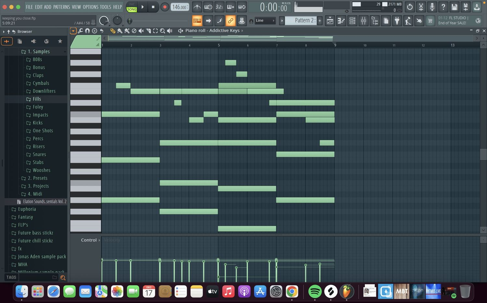
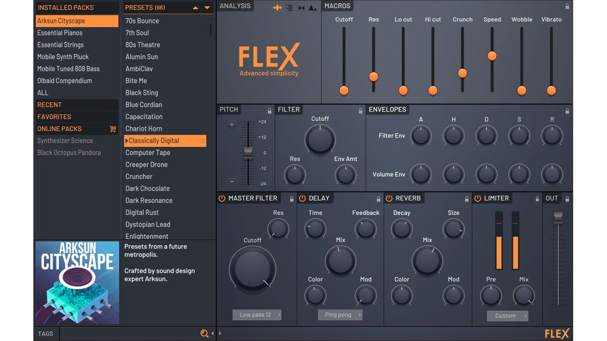
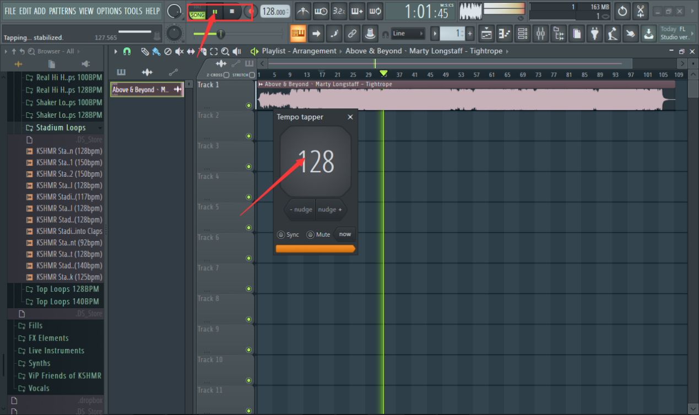
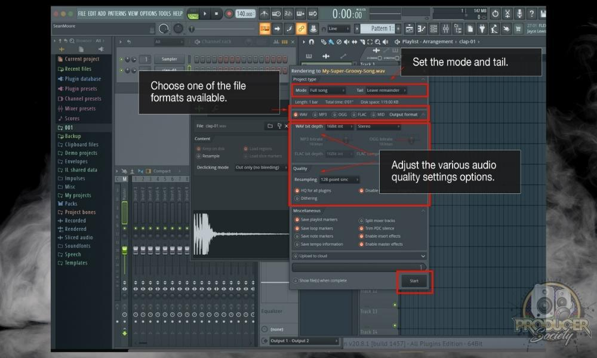

# NoteCraft

W ramach projektu zaplanowana została aplikacja desktopowa do tworzenia melodii (uproszczony fragment DAW, w stylu np. FL Studio). Użytkownik układa nuty w piano rollu, wybiera instrument, ustawia tempo i odtwarza muzykę na żywo. Dźwięk generuje własny, prosty syntezator.

## Piano roll

Edytor melodii na siatce czas x wysokość dźwięku. Dodawanie, przesuwanie i usuwanie nut myszą oraz skalowanie widoku.



_Przykład piano rolla w FL Studio: nuty na siatce, klawiatura po lewej, velocity na dole._

## Syntezator i instrumenty

Własny silnik audio z generatorami fal takich jak sinusoida, prostokąt, piła. Kilka presetów instrumentów (np. Piano, Bass, Synth) z możliwością zmiany parametrów.



_Przykład panelu syntezatora FLEX w FL Studio: wybór presetu oraz parametry brzmienia (filtry, obwiednie, efekty)._

## Odtwarzanie

Polifonia (kilka nut jednocześnie), miksowanie, Play / Pause / Stop. Synchronizacja z tempem BPM i wskaźnik aktualnej pozycji na piano rollu.



_Kontrola odtwarzania i tempa w FL Studio: Play/Pause oraz BPM._

## Pliki MIDI i projekty

Aplikacja będzie umożliwiać import i eksport MIDI oraz zapis/odczyt własnych projektów (nuty, tempo, instrumenty).



_Przykład eksportu projektu w FL Studio: wybór trybu, formatu wyjściowego i jakości._

## Wykorzystanie AI

Wstępny brainstorming i dopracowanie tematu, podział implementacji na kroki i przypisanie do osób w zespole zostały wykonane przy pomocy modelu GPT-6 Luna ([https://chatgpt.com/](https://chatgpt.com/)). Link do konwersacji: [https://chatgpt.com/share/6af2189c-ce94-83ed-8eb1-41969f292c77](https://chatgpt.com/share/6af2189c-ce94-83ed-8eb1-41969f292c77)

## Uruchomienie (dev)

Wymagania: Windows, Visual Studio 2022 (workload C++), CMake ≥ 3.28, Git, [vcpkg](https://github.com/microsoft/vcpkg).

### 1. vcpkg

```powershell
git clone https://github.com/microsoft/vcpkg.git C:\vcpkg
C:\vcpkg\bootstrap-vcpkg.bat
```

Ustaw zmienną środowiskową dla usera:

```powershell
[Environment]::SetEnvironmentVariable("VCPKG_ROOT", "C:\vcpkg", "User")
```

`VCPKG_ROOT` może wskazywać na dowolną ścieżkę z Twoim klonem vcpkg.

### 2. Konfiguracja i build

Zależności są w [`vcpkg.json`](vcpkg.json) , vcpkg doinstaluje je przy configure.

**Cursor / VS Code:** zainstaluj rekomendowane rozszerzenia, wybierz preset **Windows x64 + vcpkg**, Build.

**Terminal:**

```powershell
cmake --preset default
cmake --build --preset debug
.\build\Debug\NoteCraft.exe
```

**Uwaga (MSYS2):** jeśli `where.exe cmake` jako pierwsze pokazuje `C:\msys64\ucrt64\bin\cmake.exe`, vcpkg może wywalić się na `zlib` (`RC1107`). Ustaw `C:\Program Files\CMake\bin` wyżej w PATH użytkownika albo usuń `msys64\ucrt64\bin` z PATH przy budowaniu NoteCraft.
